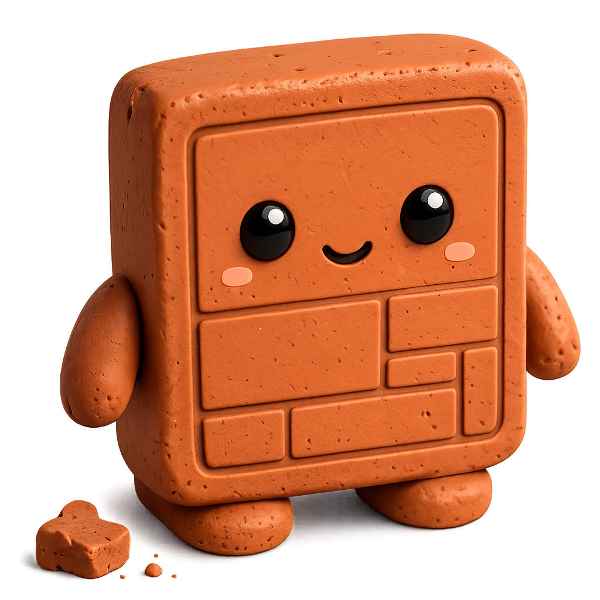
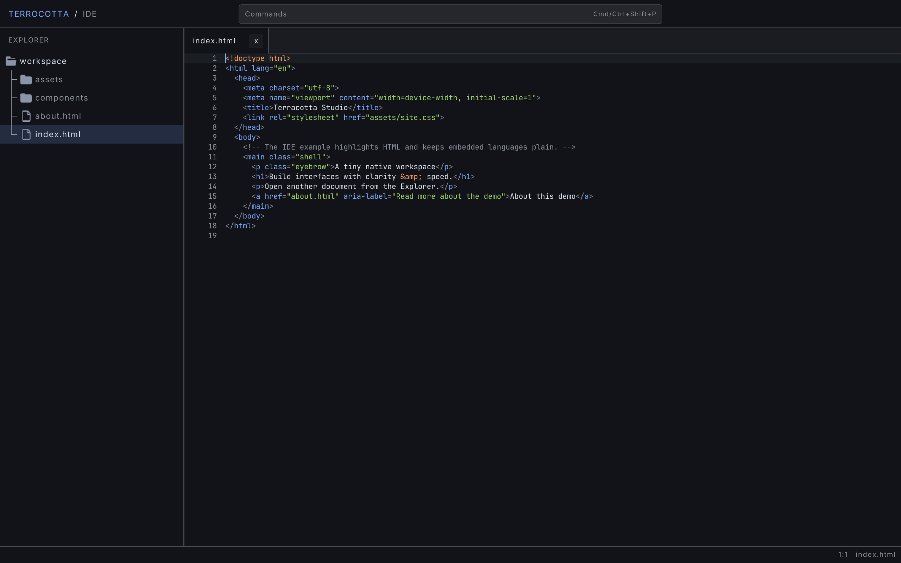
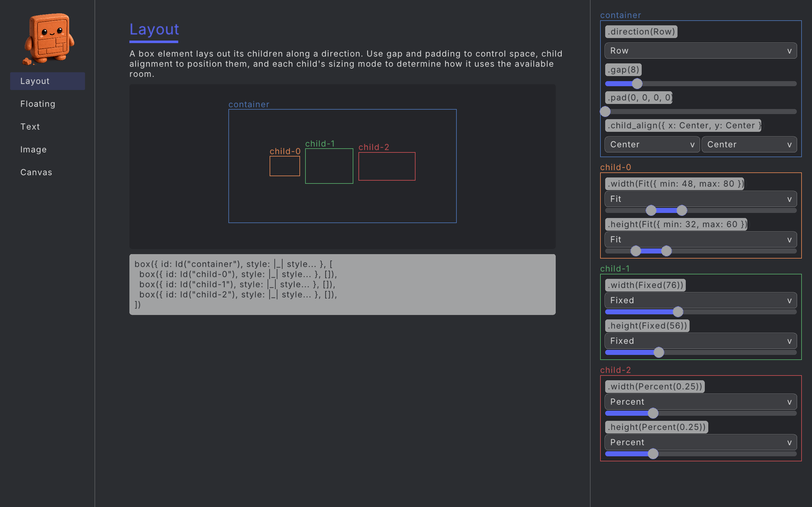
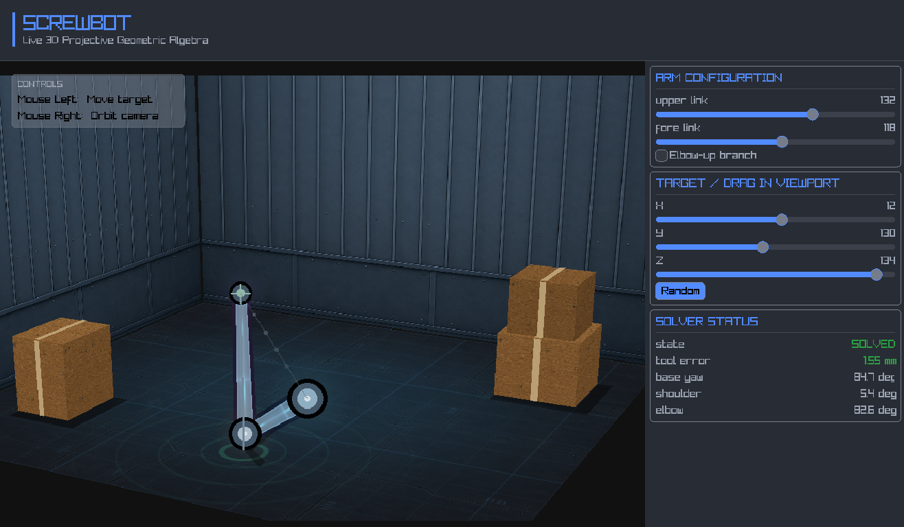
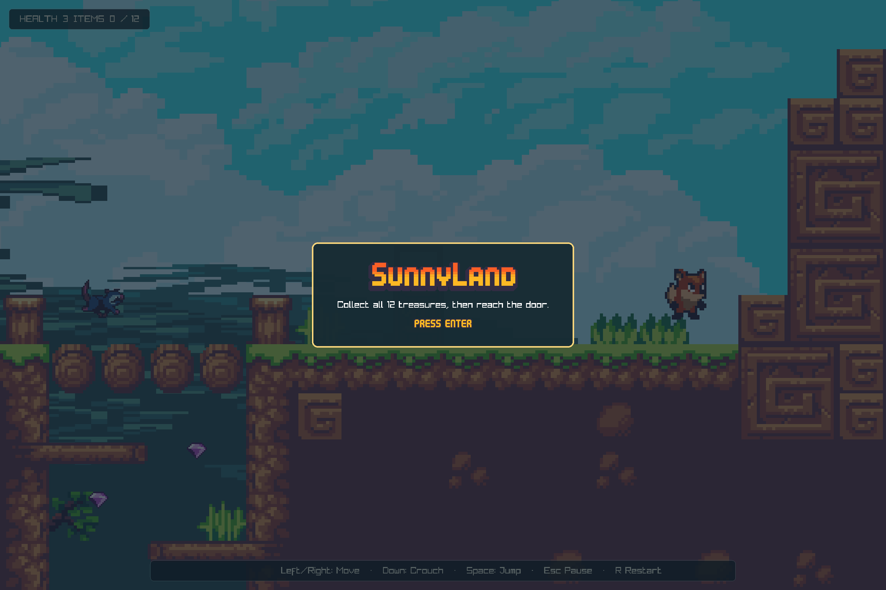

# Terrocotta - Clay meets Roc

<div align="center">
    
</div>

Terrocotta is a library for building native applications in [Roc](https://roc-lang.org/).

It is an experimental project used to explore Roc, immediate-mode
UI architecture, layout, rendering, and native application development. Its API
is still evolving.

<p align="center">
  <a href="./examples/ide/README.md">
    
  </a>
</p>

<p align="center"><em>Terrocotta IDE demo with a file explorer, document tabs, and syntax-highlighted source code</em></p>

## Features

- Model-View-Update (MVU) architecture.
- Immediate mode UI.
- 4 core elements: `box(attributes, children)`, `text(content)`, `image(texture)` and `canvas(callback)`.
- [Clay](https://github.com/nicbarker/clay) layout engine ported to Roc: flexbox, floating, stack-based node layout.
- [raylib](https://www.raylib.com/) Rendering: using the [roc-ray](https://github.com/lukewilliamboswell/roc-ray) platform.
- Theming: 6 seed colors generate 35 role-based color palette
- Widgets: see [examples](#examples)

NB: Theming and widgets are just proof of concept implementations. Users are likely to build their own UI toolkit.

## Documentation

- [Architecture Overview](docs/architecture.md)
- [Text Measurement Cache](docs/text_cache.md)

## Examples

Quick counter example:

```roc
import terrocotta.Element exposing [box, text, style]
import terrocotta.Program exposing [View]

AppModel : { count : I32 }

Msg : [Decrement, Increment]

init! : Config => Try(AppModel, [Exit(I64), ..])
init! = |_config| Ok({ count: 0 })

update! : AppModel, Msg => AppModel
update! = |model, msg| match msg {
	Decrement => { ..model, count: model.count - 1 }
	Increment => { ..model, count: model.count + 1 }
}

white = 0xFFFFFF.Color
blue = 0x2196F3.Color

button : Str, Msg -> View(Msg)
button = |label, msg| {
	box(
		{
			id: Auto,
			style: |status| style
				.width(Fit({}))
				.pad(8, 8, 8, 8)
				.background(if status.hovered { blue.darken(50) } else { blue })
				.font_color(white)
				.font_size(16),
			events: [OnClick(msg)],
		},
		[
			text(label),
		],
	)
}

view : AppModel -> View(Msg)
view = |model| {
	box(
		{ style: |_| style.direction(Row).height(Fit({})).gap(8).font_size(16) },
		[
			button("-", Decrement),
			text("Count: ${model.count.to_str()}"),
			button("+", Increment),
		],
	)
}
```

### More examples

- `roc examples/counter.roc`: key and pointer event handling
- `roc examples/todos.roc`: nested components, input-text/toggle state management
- `roc examples/widgets.roc`: button, toggle, checkbox, slider, text-input, color picker, etc.
- `roc examples/tutorial/main.roc`: interactive tutorial on layout, floating, text, image, canvas
- `roc examples/ide/main.roc`: an IDE-like demo with files, tabs, editing, overlays, and asynchronous effects
- `roc examples/screwbot/main.roc`: a CAD-like app demo
- `roc examples/game-sunnyland/main.roc`: a playable platformer demonstrating real-time input, custom canvas rendering, UI overlays, capability-scoped assets and audio, and pure game state

<table>
  <tr>
    <td align="center" width="50%">
      <a href="./examples/tutorial/README.md"><strong>Tutorial</strong></a><br />
      <p>An interactive `terrocotta` tutorial</p><br />
      
    </td>
    <td align="center" width="50%">
      <a href="./examples/ide/README.md"><strong>IDE</strong></a><br />
      <p>A proof-of-concept IDE</p><br />
      
    </td>
  </tr>
  <tr>
    <td align="center" width="50%">
      <a href="./examples/screwbot/README.md"><strong>Screwbot</strong></a><br />
      <p>A CAD inverse kinematic workbench</p><br />
      
    </td>
    <td align="center" width="50%">
      <a href="./examples/game-sunnyland/README.md"><strong>Sunnyland</strong></a><br />
      <p>A 2D platformer game</p><br />
      
    </td>
  </tr>
</table>
