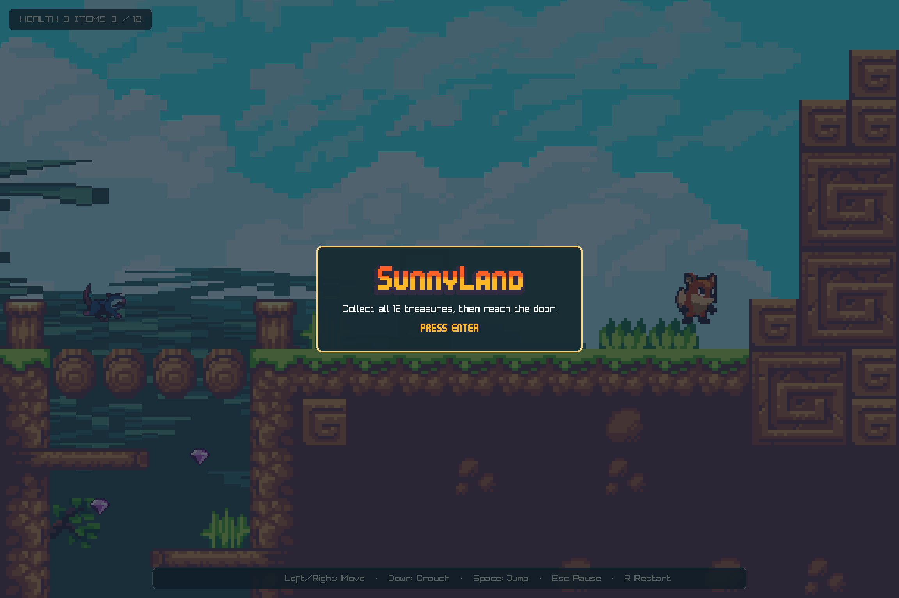

# Terrocotta Sunnyland example

This playable 2D platformer shows how Terrocotta can compose a custom-rendered
game world with responsive UI overlays, capability-scoped assets and audio, and
a deterministic gameplay model. It uses roc-ray for the game canvas while
Terrocotta owns the application lifecycle, layout, input routing, and interface.

The example features:

- a pure gameplay simulation with explicit controls and events
- platforming with coyote time, jump buffering, and variable jump height
- solid and one-way tile collision
- animated enemies, collectibles, player states, and pickup feedback
- a clamped scrolling camera over a textured tilemap
- capability-scoped texture and music loading
- 400 FPS



## Run

Run the example from the repository root with:

```sh
roc --opt=speed examples/game-sunnyland/main.roc
```

Try these interactions:

- Press `Enter` to advance through the title and instructions.
- Move with the left/right arrows or `A`/`D`.
- Press `Space` to jump, then release it early for a shorter jump.
- Hold the down arrow or `S` while grounded to crouch.
- Collect all six cherries and six gems while avoiding or stomping enemies.
- Return to the house door after collecting every item to win.
- Press `Escape` to pause or resume; press `R` while paused to restart.
- Press `Enter` after death or victory to return to the title.

## Terrocotta capabilities on display

| Capability                                          | Representative code                                                                                      |
| --------------------------------------------------- | -------------------------------------------------------------------------------------------------------- |
| Model-View-Update lifecycle and message routing     | [`main.roc`](main.roc), [`ui/UI.roc`](ui/UI.roc)                                                         |
| Custom canvas drawing inside responsive layout      | [`main.roc`](main.roc), [`world/Render.roc`](world/Render.roc)                                           |
| Floating overlays, event capture, and passthrough   | [`ui/UI.roc`](ui/UI.roc)                                                                                 |
| Keyboard input translated into domain controls      | [`main.roc`](main.roc), [`Game.roc`](Game.roc)                                                           |
| Capability-scoped texture and audio loading         | [`main.roc`](main.roc), [`GameAssets.roc`](GameAssets.roc)                                               |
| Camera transforms and texture-based world rendering | [`world/Render.roc`](world/Render.roc), [`render/LevelView.roc`](render/LevelView.roc)                   |
| Sprite atlases, animation, tinting, and flipping    | [`render/SpriteSheet.roc`](render/SpriteSheet.roc), [`render/SunnySprites.roc`](render/SunnySprites.roc) |
| Pure state transitions and gameplay event emission  | [`Game.roc`](Game.roc), [`player/Fox.roc`](player/Fox.roc), [`core/Collision.roc`](core/Collision.roc)   |
| Deterministic frame capture                         | [`main.roc`](main.roc)                                                                                   |

Sunnyland complements the IDE and Screwbot examples. The IDE emphasizes
stateful application UI and asynchronous effects, while Screwbot emphasizes a
custom graphical workbench. Sunnyland demonstrates the same composition model
in a real-time game loop with a pure simulation behind the rendered scene.

## Architecture

```text
main.roc                         lifecycle, input, capabilities, and UI composition
  ├── GameAssets.roc             capability-scoped textures, sprite data, and music
  ├── Game.roc                   world state, transitions, and ordered simulation
  ├── core/
  │   └── Collision.roc          solid and one-way axis-aligned collision
  ├── player/
  │   └── Fox.roc                movement, health, animation state, and respawning
  ├── enemies/                   frog, eagle, and opossum behavior
  ├── pickups/                   collectibles and collection feedback
  ├── world/
  │   ├── Level.roc              bounds, camera policy, spawns, and objective
  │   ├── LevelData.roc          generated tile and collision metadata
  │   └── Render.roc             camera setup and world render ordering
  ├── render/                    tilemap, sprite-sheet, and entity drawing
  └── ui/
      └── UI.roc                 HUD and title/pause/death/victory overlays
```

`main.roc` translates roc-ray input snapshots into `Game.Controls` and passes a
frame message through Terrocotta's update loop. `Game.update` advances the pure
world and returns gameplay events. The application interprets effectful events,
such as starting the looping music, without putting those effects into the game
model.

Rendering follows the same boundary in the other direction. `world/Render.roc`
creates a camera from the resolved canvas bounds and draws the current world;
`ui/UI.roc` independently builds Terrocotta elements for the HUD and modal game
states. Floating capture policies let modal overlays block interaction while
the HUD passes input through to the canvas.

The checked-in `world/LevelData.roc` is generated from the Phaser map by
`tools/import_map.py`. Runtime code consumes typed Roc data and does not parse
the source JSON.

## Limitations

This example demonstrates Terrocotta rather than attempting to be a complete
platformer engine:

- It contains one compact, fixed level with hard-coded entity and objective
  placements.
- Collision uses axis-aligned rectangles and supports solid and top-only
  platforms; slopes and moving platforms are out of scope.
- Enemy behaviors are intentionally small and have no navigation system.
- Gameplay state is held in memory and is not persisted between runs.
- Gameplay events are modeled for sound and feedback integration, but the
  current audio implementation plays background music only.

These constraints keep the gameplay code small enough to study while still
exercising Terrocotta's real-time input, canvas, asset, audio, overlay, and
state-composition boundaries.

## Assets and licenses

SunnyLand artwork is by **ansimuz (Luis Zuno)** and comes from
[SunnyLand – Free Pixel Game Art Assets Pack](https://ansimuz.itch.io/sunny-land-pixel-game-art).
The artwork is licensed under
[CC0 1.0 Universal](https://creativecommons.org/publicdomain/zero/1.0/).
Attribution is not required, but is included here in appreciation of the
creator.

The background track, `platformer_level03_loop.ogg`, is by **Pascal Belisle**:

- <https://www.patreon.com/thetoadz>
- <https://www.soundcloud.com/thetoadz>

The artwork and music do not share the same license. See
[`THIRD_PARTY_NOTICES.md`](THIRD_PARTY_NOTICES.md) and the preserved
[`LICENSES/Pascal-Belisle-Music.txt`](LICENSES/Pascal-Belisle-Music.txt) before
redistributing the example or its assets.
