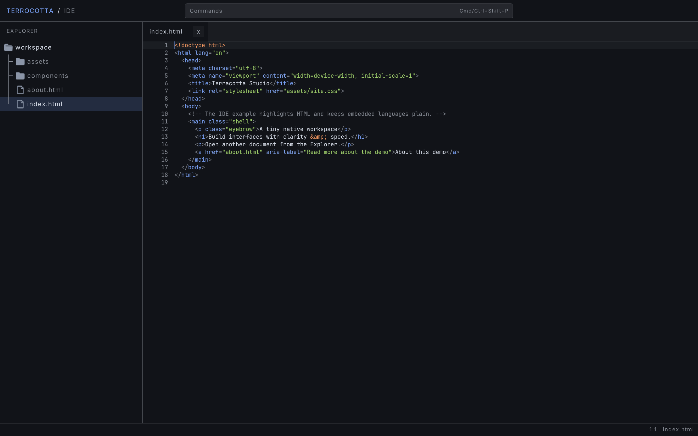

# Terrocotta IDE example

This proof-of-concept IDE shows how Terrocotta's small set of UI primitives can
be composed into a stateful native application.

The example features:

- collapsible and resizable file explorer
- document tabs
- editable code surface
- HTML and CSS highlighting
- command palette
- file search
- keyboard shortcuts
- clipboard integration
- undo and redo
- asynchronous file loading and saving.



## Run

Run the example with:

```sh
roc examples/ide/main.roc
```

Try these interactions:

- Drag the explorer's right edge to resize it, then expand and collapse folders.
- Open several files and switch between or close their tabs.
- Press `Cmd/Ctrl+P` to search for a file.
- Press `Cmd/Ctrl+Shift+P` to search for an application command.
- Edit HTML or CSS and watch highlighting update with the document.
- Select text with the pointer or keyboard, then copy, paste, undo, and redo.
- Press `Cmd/Ctrl+S` to save. A `*` beside the tab name marks unsaved changes.
- Press `Cmd/Ctrl+K` to see all registered keyboard shortcuts.

## Terrocotta capabilities on display

| Capability                                               | Representative code                                                                          |
| -------------------------------------------------------- | -------------------------------------------------------------------------------------------- |
| Model-View-Update composition and message mapping        | [`App.roc`](App.roc)                                                                         |
| Flex layout, styling, hover state, and nested components | [`ui/Explorer.roc`](ui/Explorer.roc), [`ui/Editor.roc`](ui/Editor.roc)                       |
| Floating overlays, focus, and the text-input widget      | [`ui/CommandPalette.roc`](ui/CommandPalette.roc)                                             |
| Pointer events and drag interaction                      | [`ui/Explorer.roc`](ui/Explorer.roc), [`ui/CodeEditor.roc`](ui/CodeEditor.roc)               |
| Overflow and scrolling                                   | Vertical explorer/palette scrolling, horizontal tabs, and editor viewport scrolling          |
| Custom canvas drawing                                    | Source rendering and explorer tree guides                                                    |
| Asynchronous effects routed back through messages        | File loading and saving in [`ui/Editor.roc`](ui/Editor.roc)                                  |
| Capability-scoped filesystem and clipboard access        | [`main.roc`](main.roc)                                                                       |
| Asset and font loading                                   | [`App.roc`](App.roc), [`ui/Explorer.roc`](ui/Explorer.roc), [`ui/Editor.roc`](ui/Editor.roc) |
| Seed-based theming                                       | [`Theme.roc`](Theme.roc)                                                                     |
| Deterministic frame capture                              | [`App.roc`](App.roc)                                                                         |

This is intentionally a larger integration example. For isolated introductions
to layout and rendering primitives, start with the repository's counter,
widgets, and interactive tutorial examples.

## Architecture

```text
main.roc                         platform configuration and capabilities
  App.roc                       top-level state, message routing, and layout
  ├── Workspace.roc             bounded discovery of the sample workspace
  ├── ui/
  │   ├── Explorer.roc          tree state, file-open actions, and resizing
  │   ├── CommandPalette.roc    file/command search and floating overlays
  │   ├── Editor.roc            tabs, history, clipboard, and file effects
  │   │   ├── Tabs.roc          collection and active-tab policy
  │   │   └── CodeEditor.roc    rendering and interaction-derived edit intents
  │   └── Keybindings.roc       shared command and shortcut registry
  └── source/
      ├── Buffer.roc            source text and all derived document state
      ├── LineEndings.roc       LF/CRLF detection and boundary conversion
      ├── Highlight.roc         language selection and highlighter dispatch
      ├── Syntax.roc            language-independent highlight spans
      ├── Html.roc              forgiving HTML lexer
      └── Css.roc               forgiving CSS lexer
```

The application follows MVU at more than one level. UI components own local
models and messages, then return either updated state or a small action for a
parent to interpret. For example, the explorer emits `OpenFile`, and `App`
routes that action to the editor without coupling the two component models.

The editor is split along a similar boundary.

- `CodeEditor` renders an immutable buffer snapshot and translates keyboard and pointer input into language-independent commands.
- `Editor` applies those commands, owns tab and history state, and performs clipboard and filesystem effects.
- `Buffer` keeps source text, line geometry, language selection, and highlight ranges coherent by rebuilding all derived state after an edit.

File loading and saving are asynchronous. Each tab permits at most one save at
a time, and a save writes the snapshot that existed when it began. Editing may
continue while that write is in flight; when it completes, newer content
correctly remains marked as dirty.

LF and CRLF documents share one internal representation: loading normalizes
line endings to LF, while each tab remembers the file's original style and
restores it when saving. Clipboard text crosses the same normalization
boundary without changing the document's saved line-ending style.

## Limitations

This example demonstrates Terrocotta rather than attempting to be a
production-ready editor:

- Documents accept printable ASCII with LF or CRLF line endings. Cursor
  positions, highlight spans, and fixed-width glyph positions can therefore
  share byte offsets over normalized LF content. Tabs remain unsupported.
- Mixed LF/CRLF files and classic Mac CR-only files are rejected rather than
  silently rewritten.
- Every edit rebuilds line geometry and syntax highlighting for the full file.
- The HTML and CSS highlighters are small, forgiving lexers rather than parsers.
- Split panes, language servers, incremental parsing, and other production IDE
  facilities are out of scope.

These constraints keep the example small enough to study while preserving the
interesting UI architecture and effect-handling paths.

## Assets and licenses

The UI uses the bundled `assets/Inter-Regular.ttf` font, while the code editor
uses `assets/JetBrainsMono-Regular.ttf`. JetBrains Mono is distributed under
the SIL Open Font License 1.1; its license is included at
`assets/JetBrainsMono-OFL.txt`.

The explorer icons are transparent 16 px renderings of GitHub Octicons. Their
names, provenance, and color treatment are documented in
[`assets/ICONS.md`](assets/ICONS.md), and the Octicons MIT license is included
at `assets/OCTICONS-LICENSE.txt`.
