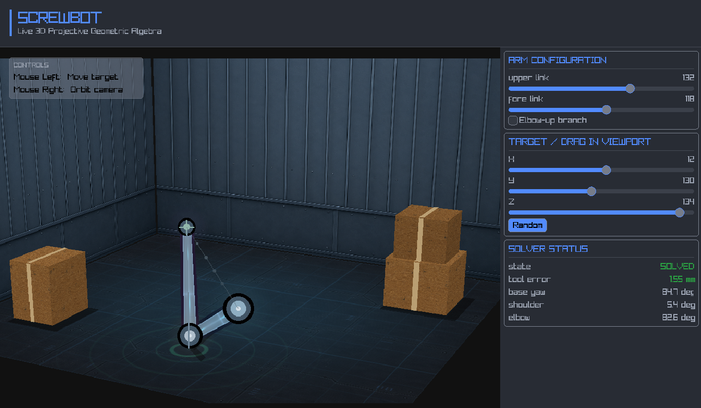

# Terrocotta Screwbot example

This interactive inverse-kinematics workbench shows how Terrocotta can combine
a conventional control interface with a custom-rendered scene. It places a
two-link robot arm in a warehouse and exposes the arm configuration, target,
solver state, and joint angles in a live inspector.

The example features:

- a draggable inverse-kinematics target
- an orbiting camera
- adjustable link lengths and elbow branch
- reachable and out-of-reach visual states
- live solver measurements
- textured projective geometry
- custom fragment shaders
- a responsive, scrollable inspector
- 260 FPS



## Run

Run the example with:

```sh
roc --opt=speed examples/screwbot/main.roc
```

Try these interactions:

- Left-drag in the viewport to move the target and update the solved arm pose.
- Right-drag in the viewport to orbit the camera.
- Adjust the upper-link and fore-link controls in the inspector.
- Toggle the elbow-up branch to select the other inverse-kinematics solution.
- Press **Random** to move the target among several preset positions.
- Move the target beyond the arm's reach and observe the solver status, error
  measurement, target marker, and materials change together.
- Resize the window and observe the viewport letterboxing and inspector
  scrolling.

## Terrocotta capabilities on display

| Capability                                               | Representative code                                                            |
| -------------------------------------------------------- | ------------------------------------------------------------------------------ |
| Model-View-Update composition and message mapping        | [`main.roc`](main.roc)                                                         |
| Flex layout, styling, and nested components              | [`main.roc`](main.roc), [`ui/Inspector.roc`](ui/Inspector.roc)                 |
| Custom canvas drawing                                    | [`ui/Viewport.roc`](ui/Viewport.roc), [`scene/Scene.roc`](scene/Scene.roc)     |
| Pointer events and drag interaction                      | [`ui/Viewport.roc`](ui/Viewport.roc), [`scene/Camera.roc`](scene/Camera.roc)   |
| Floating overlays and event passthrough                  | [`ui/Viewport.roc`](ui/Viewport.roc)                                           |
| Widgets and vertical overflow                            | [`ui/Inspector.roc`](ui/Inspector.roc)                                         |
| Seed-based theming                                       | [`main.roc`](main.roc), [`ui/Utils.roc`](ui/Utils.roc)                         |
| Capability-scoped asset loading                          | [`main.roc`](main.roc)                                                         |
| Render textures, shaders, and projective texture drawing | [`scene/Scene.roc`](scene/Scene.roc), [`scene/Drawing.roc`](scene/Drawing.roc) |

Screwbot complements the IDE example: the IDE emphasizes application state,
text editing, and asynchronous effects, while Screwbot emphasizes custom canvas
rendering and interaction with a graphical workspace.

## Architecture

```text
main.roc                         startup, resources, message routing, and layout
  ├── ui/
  │   ├── Topbar.roc            title and demo slogan
  │   ├── Inspector.roc         arm, target, and solver controls
  │   ├── Viewport.roc          pointer input, overlay, and canvas presentation
  │   └── Utils.roc             shared Screwbot-styled UI helpers
  └── scene/
      ├── Scene.roc             world state and offscreen render pipeline
      ├── Camera.roc            orbit state, projection, and pointer unprojection
      ├── Robot.roc             robot state and rendering
      ├── RobotKinematics.roc   inverse-kinematics solver and PGA construction
      ├── Warehouse.roc         static environment geometry and textures
      ├── Drawing.roc           reusable immediate-mode drawing primitives
      ├── FloorMaterial.roc     floor shader and typed uniform bindings
      └── RobotMaterial.roc     robot shader and typed uniform bindings
```

The application separates UI interaction from scene state. `Viewport` and
`Inspector` emit local messages, and `main.roc` maps them into `Scene.Msg`.
`Scene` owns the world and render resources; its robot and camera branches are
updated independently.

The inverse-kinematics solution is derived from the current robot state for
each view rather than stored alongside it. The same solution feeds the robot
geometry, status readouts, and shader inputs, keeping the visual and textual
representations in sync.

The viewport is an `Element.canvas` whose callback receives its resolved
bounds. `Scene.render!` draws the warehouse and robot into a fixed-size render
texture, then scales and letterboxes that texture into the canvas. Pointer
coordinates cross the opposite boundary: `Camera.target_from_pointer` maps a
position in the laid-out canvas back into the scene.

## Limitations

This example demonstrates Terrocotta rather than attempting to be a robotics
simulator or general-purpose 3D engine:

- The arm uses a closed-form, two-link inverse-kinematics solver; it has no
  dynamics, collision detection, joint limits, or path planning.
- The scene uses custom projection and ordered 2D drawing rather than a depth
  buffered 3D renderer.
- Left-dragging moves the target on a plane at its current camera depth rather
  than manipulating independent world-space axes.
- The scene renders at a fixed 900 x 620 resolution before being letterboxed
  into the available viewport.
- Arm configuration, target position, and camera state are not persisted.

These constraints keep the scene and its interaction model compact enough to
study while still exercising Terrocotta's canvas and composition boundaries.

## Assets and licenses

The following Screwbot material textures are provided by
[Poly Haven](https://polyhaven.com/) under the
[CC0 1.0 license](https://creativecommons.org/publicdomain/zero/1.0/).
Attribution is not required, but is included here to preserve provenance.

| Local file              | Asset                                  | Author             | Source                                                      |
| ----------------------- | -------------------------------------- | ------------------ | ----------------------------------------------------------- |
| `screwbot-wall.png`     | Corrugated Iron 03, 1K diffuse PNG     | Charlotte Baglioni | [Poly Haven](https://polyhaven.com/a/corrugated_iron_03)    |
| `screwbot-floor.png`    | Hangar Concrete Floor, 1K diffuse PNG  | Dimitrios Savva    | [Poly Haven](https://polyhaven.com/a/hangar_concrete_floor) |
| `screwbot-crate-v2.png` | Cardboard Box 01 model, 1K diffuse PNG | Rahul Chaudhary    | [Poly Haven](https://polyhaven.com/a/cardboard_box_01)      |

Screwbot samples a clean rectangular portion of the Cardboard Box model's
diffuse atlas at runtime, then draws its own projected seams and tape. The
original texture file is otherwise unmodified.

Direct downloads:

- <https://dl.polyhaven.org/file/ph-assets/Textures/png/1k/corrugated_iron_03/corrugated_iron_03_diff_1k.png>
- <https://dl.polyhaven.org/file/ph-assets/Textures/png/1k/hangar_concrete_floor/hangar_concrete_floor_diff_1k.png>
- <https://dl.polyhaven.org/file/ph-assets/Models/png/1k/cardboard_box_01/cardboard_box_01_diff_1k.png>
